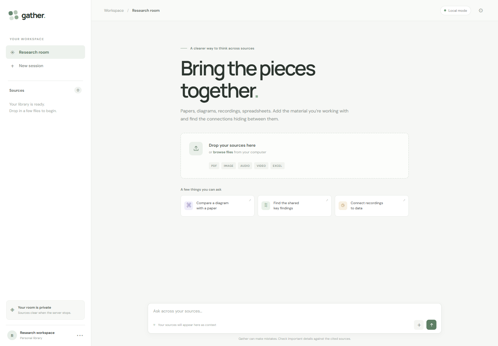
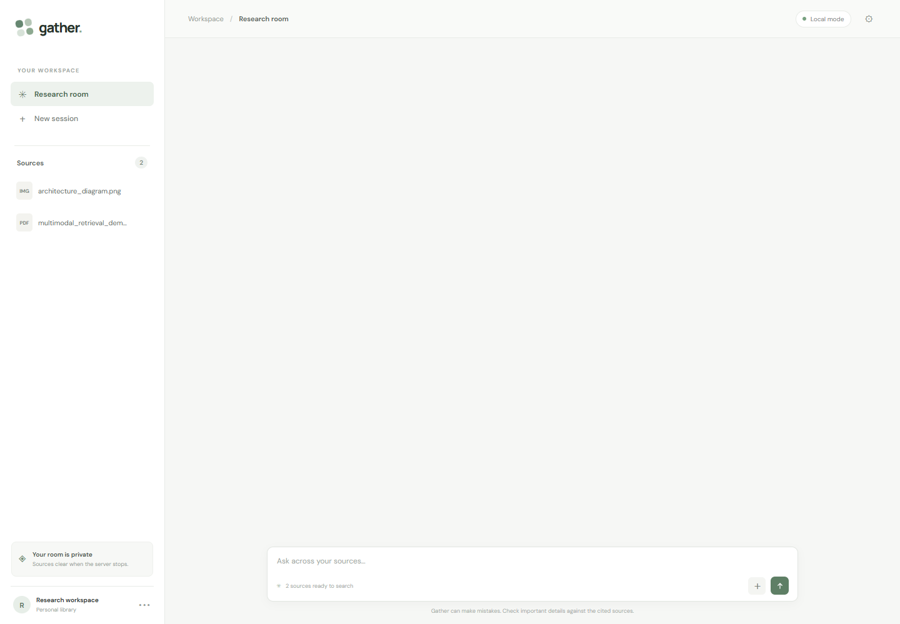
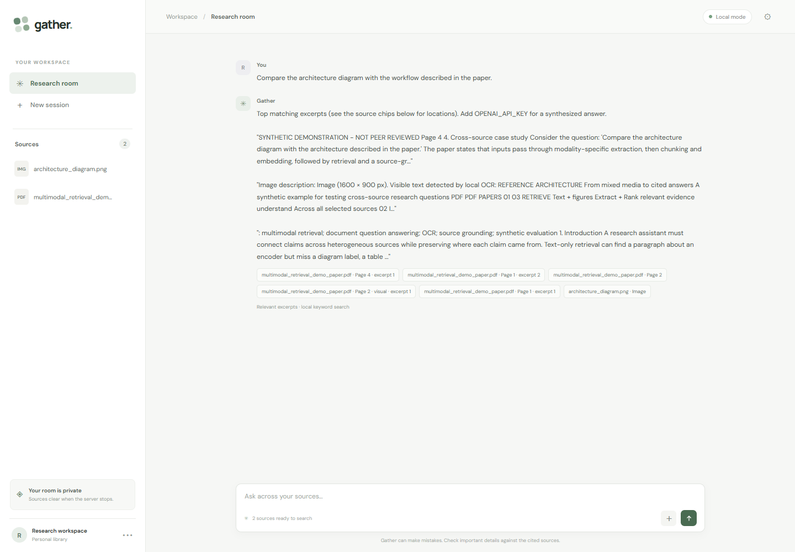

# Gather - Multimodal Research Assistant

Ask questions across research papers, diagrams, recordings, videos, and spreadsheets. Gather extracts source-aware text, retrieves relevant passages across files, and returns answers with source references.

## Screenshots

| Research room | Sources loaded |
| --- | --- |
|  |  |



## Features

- Upload PDF, PNG, JPEG, WebP, GIF, audio, video, Excel, and text files.
- Extract PDF text and page references; use local OCR to index labels in images and scanned or illustrated PDF pages.
- Transcribe audio and sample video frames when an OpenAI API key is configured.
- Parse Excel workbooks by sheet and row range.
- Search across uploaded sources with OpenAI embeddings or local keyword ranking.
- Ask cross-file questions and see the supporting source excerpts and locations.
- Run locally; uploaded sources stay in memory and clear when the server restarts.

## Run locally

```powershell
py -m venv .venv
.\.venv\Scripts\Activate.ps1
pip install -r requirements.txt
Copy-Item .env.example .env
uvicorn backend.main:app --reload
```

Open [http://127.0.0.1:8000](http://127.0.0.1:8000).

Add `OPENAI_API_KEY` to `.env` for visual interpretation, audio transcription, embeddings, and synthesized answers. In Local mode, image and PDF uploads use RapidOCR to index visible text, and questions return relevant source excerpts. Full visual layout interpretation requires the API key.

## Try the sample materials

Upload `sample_data/architecture_diagram.png` and `output/pdf/multimodal_retrieval_demo_paper.pdf`, then ask:

> Compare the architecture diagram with the workflow described in the paper.

The sample paper and chart are synthetic fixtures. All reported values are fictional and are included only to exercise ingestion, OCR, retrieval, and citations.

Regenerate the sample images and paper with:

```powershell
python sample_data/generate_demo_assets.py
```

## Stack

Python, FastAPI, OpenAI API, RapidOCR, PyMuPDF, OpenCV, OpenPyXL, and vanilla HTML/CSS/JavaScript.

## Current scope

This starter is for a single-user local workspace. The index is in memory; there is no authentication, persistent vector database, or multi-user isolation. Add those before exposing it to a network.
